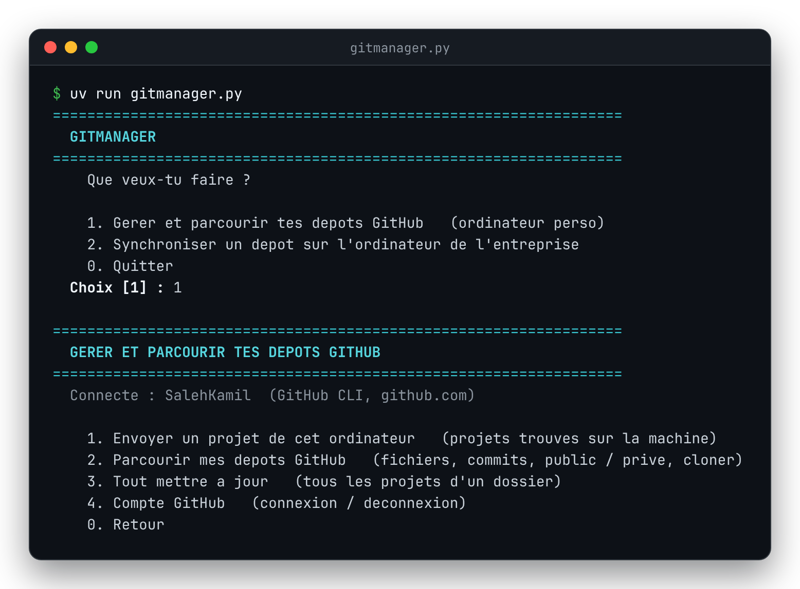

<p align="center"></p>

<h1 align="center">gitmanager</h1>

<p align="center">
  Code chez toi, pousse au bureau, et gère tes dépôts GitHub
  en local comme en ligne.<br>
  <sub>Code at home, push at work, and manage your GitHub repos locally and online.</sub>
</p>

<p align="center">
    
</p>

<p align="center"></p>

`gitmanager.py` est un script Python qui remplace les commandes Git par des
menus. Au lancement, il demande ce qu'on veut faire : gérer ses dépôts GitHub
depuis son PC perso, ou synchroniser un dépôt sur l'ordinateur de
l'entreprise.

Le script tient en un seul fichier et n'utilise que la bibliothèque standard
de Python. Il se lance avec `uv run gitmanager.py` ou `python gitmanager.py`.

Les échanges passent seulement par HTTPS ou SSH, et aucun jeton n'est écrit
sur le disque. La partie [Sécurité](#5-sécurité) détaille ces protections.

## Sommaire

1. [Prérequis](#1-prérequis)
2. [Installation et lancement](#2-installation-et-lancement)
3. [Utilisation](#3-utilisation)
4. [Connexion](#4-connexion)
5. [Sécurité](#5-sécurité)
6. [Limites](#6-limites)
7. [Dépannage](#7-dépannage)
8. [Ce qui a été vérifié](#8-ce-qui-a-été-vérifié)
9. [Fichiers](#9-fichiers)

## 1. Prérequis

- Python 3.9 ou plus, ou bien `uv`, qui fournit l'interpréteur ;
- Git 2.31 ou plus, parce que le script lui passe ses réglages de sécurité
  par l'environnement ;
- pour se connecter par le navigateur, GitHub CLI (`gh`) ou Git Credential
  Manager, inclus dans Git pour Windows. Sans eux, un jeton d'accès suffit.

```bash
winget install --id Git.Git -e    # Windows : Git et Git Credential Manager
brew install git gh               # macOS
sudo apt install git gh           # Debian, Ubuntu
```

## 2. Installation et lancement

1. Récupérer le script :

   ```bash
   git clone https://github.com/SalehKamil/GITManager.git
   cd GITManager
   ```

2. Le lancer :

   ```bash
   uv run gitmanager.py    # uv fournit Python si besoin
   python gitmanager.py    # ou avec le Python déjà installé
   ```

3. Répondre à « Que veux-tu faire ? » : `1` sur le PC perso, `2` sur
   l'ordinateur de l'entreprise. Le choix est proposé par défaut au
   lancement suivant.

Le script garde ses réglages dans `~/.gitmanager.json` : le dernier choix,
les derniers dossiers, le dépôt à récupérer et l'adresse du dépôt de
l'entreprise. Ce fichier ne contient aucun mot de passe ni jeton.

## 3. Utilisation

Chaque menu attend un numéro suivi d'Entrée, et une réponse vide garde la
valeur proposée entre crochets.

### Choix 1 : gérer et parcourir tes dépôts GitHub

Le script se connecte au compte GitHub, puis cherche les projets Git de la
machine dans les dossiers habituels (dossier personnel, Documents, Bureau,
Projects, `source/repos`) et les derniers dossiers ouverts.

| Pour | Réponses à taper | Ce qui se passe |
|---|---|---|
| envoyer un projet de l'ordinateur | `1`, `1`, le numéro du projet, `1` | commit des fichiers modifiés, puis push |
| publier un dossier absent de GitHub | `1`, `1`, le chemin du dossier, `1` | `git init`, création du dépôt GitHub (privé par défaut), premier commit et push |
| récupérer les changements | `1`, `1`, le numéro du projet, `2` | pull des commits présents sur GitHub |
| mettre à jour tous ses projets | `1`, `3`, le dossier qui les contient, `1` | commit et push de chaque projet Git trouvé, puis un bilan |
| rendre un dépôt public ou privé | `1`, `2`, le numéro du dépôt, `3` | changement de visibilité, après confirmation |
| cloner un de ses dépôts | `1`, `2`, le numéro du dépôt, `4` | clone dans le dossier choisi, puis ouverture du projet |

### Choix 2 : synchroniser un dépôt sur l'ordinateur de l'entreprise

Cette fonction amène un projet de GitHub jusqu'au dépôt de l'entreprise, en
cinq étapes :

1. Le script demande le dépôt à récupérer, par exemple
   `SalehKamil/mon-projet`, et le télécharge sans identifiants dans un
   dossier temporaire. S'il est privé, il propose un jeton du compte perso
   pour cette seule récupération.
2. Il demande l'emplacement du dossier Git du dépôt de l'entreprise, ou son
   adresse pour le cloner.
3. Il vérifie l'accès au serveur de l'entreprise et, si les identifiants du
   poste ne suffisent pas, demande une seconde connexion, distincte du
   compte perso.
4. Il liste les fichiers copiés et supprimés, puis remplace le contenu du
   dossier de l'entreprise par le projet récupéré, sans toucher à son
   `.git`.
5. Il fait commit et push avec le compte de l'entreprise, puis efface le
   dossier temporaire.

Au lancement suivant, `2` puis Entrée à chaque question refait la même
synchronisation.

## 4. Connexion

| Compte | Moyens, dans l'ordre | Ce qui est gardé |
|---|---|---|
| GitHub perso | GitHub CLI ou Git Credential Manager, par le navigateur ; sinon un jeton | la connexion reste dans `gh` ou GCM, qui utilisent le coffre du système ; un jeton reste en mémoire |
| serveur de l'entreprise | identifiants déjà présents sur le poste (GCM, SSH), puis au choix : navigateur avec GCM, navigateur avec GitHub CLI, jeton ou mot de passe | un jeton est oublié à la fin de la synchronisation |
| dépôt à récupérer | aucun s'il est public, sinon un jeton du compte perso | le jeton est oublié juste après la récupération |

Un jeton se saisit sans s'afficher. Pour GitHub, le plus sûr est un jeton
fin (<ins>fine-grained</ins>), limité aux dépôts utiles.

## 5. Sécurité

<ins>Échanges chiffrés.</ins> Git n'accepte que HTTPS, SSH et les dossiers
locaux : une adresse `http://` ou `git://` est refusée. La vérification des
certificats est forcée, même si la configuration Git du poste la désactive.

<ins>Aucun secret sur le disque.</ins> Un jeton passe à Git par
l'environnement du processus, jamais par la ligne de commande, une adresse ou
un fichier. Un identifiant trouvé en clair dans l'adresse d'un dépôt est
retiré.

<ins>Fichiers secrets.</ins> Avant chaque commit, le script retire de l'envoi
les `.env`, les clés privées (`id_rsa`, `.pem`, `.key`, `.p12`),
`credentials.json` et les fichiers de plus de 100 Mo. Avant de rendre un
dépôt public, il cherche ces fichiers sur GitHub et, s'il en trouve, demande
de taper `PUBLIC`.

<ins>Copie vers l'entreprise.</ins> Les liens symboliques sont copiés comme
des liens, jamais suivis, et aucun fichier n'est écrit hors du dossier de
l'entreprise. Le dossier temporaire est effacé, même en cas d'erreur.

<ins>Actions sans retour.</ins> Le force push demande de taper `ECRASER`, la
suppression du `.git` `SUPPRIMER`, et la suppression d'un dépôt son nom.

## 6. Limites

À connaître avant de s'en servir.

<ins>Un dépôt public est lisible par tous.</ins> La récupération sans
identifiants suppose un dépôt public, dont le code et l'historique sont alors
visibles par n'importe qui. Le repasser en privé après la synchronisation, ou
utiliser un jeton du compte perso, évite cette exposition.

<ins>Remplacement complet.</ins> La synchronisation rend le dossier de
l'entreprise identique au projet récupéré. Un fichier présent seulement côté
entreprise est donc supprimé, après affichage de la liste.

<ins>Une branche à la fois.</ins> Le script travaille sur la branche courante
et ne fusionne pas de branches entre elles.

## 7. Dépannage

<ins>« Git 2.31 ou plus est requis »</ins> : installer ou mettre à jour Git
avec la commande affichée, puis rouvrir le terminal.

<ins>« Ce depot n'est pas accessible sans identifiants »</ins> : le dépôt
est privé ou son nom est faux. Le rendre public depuis le PC perso, ou
choisir `1` pour utiliser un jeton du compte perso.

<ins>« adresse non chiffree refusee »</ins> : remplacer `http://` par
`https://` dans l'adresse.

<ins>« GitHub refuse l'acces »</ins> : la connexion a expiré ou a été
révoquée. Se reconnecter avec le menu 4.

## 8. Ce qui a été vérifié

Les essais ont été faits sous Linux, avec Python 3.13 et Git 2.43 :

- deux synchronisations de suite vers un dépôt local tenant lieu de serveur
  d'entreprise, avec fichiers ajoutés, modifiés et supprimés ;
- la récupération sans identifiants d'un vrai dépôt public de GitHub ;
- le refus d'un dépôt introuvable et d'une adresse `http://` ;
- un `.env` et un lien symbolique piégé : le `.env` n'a pas été envoyé et
  rien n'a été écrit hors du dépôt ;
- le passage du jeton à Git, absent de la ligne de commande ;
- la recherche des projets de la machine, puis un commit et un push.

La connexion par le navigateur (`gh`, GCM), Windows et macOS n'ont pas été
vérifiés.

## 9. Fichiers

| Fichier | Rôle |
|---|---|
| `gitmanager.py` | le script complet |
| `docs/` | l'icône et la capture du terminal |
| `LICENSE` | la licence MIT |
